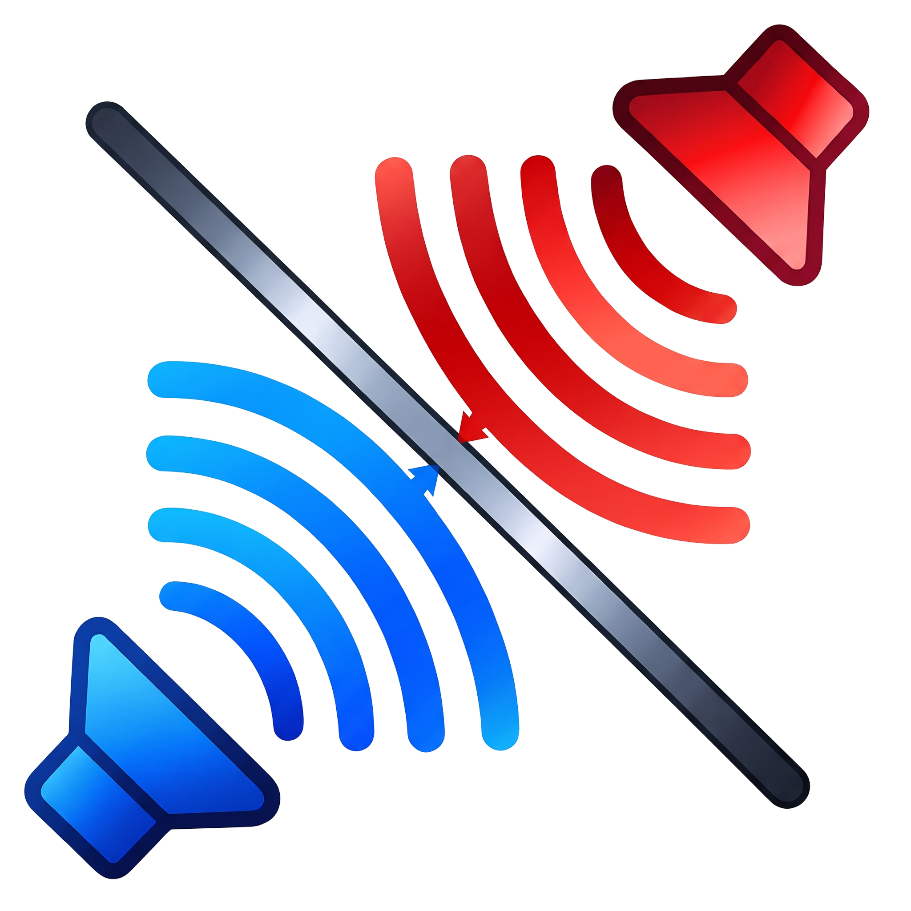

# Monitor Mirror

<p align="center">
  
</p>

<p align="center">
  <b>Ultra-low latency, zero-CPU audio mirroring and device switcher for Windows.</b><br>
  Mirror loopback audio from your primary display or headset to another endpoint with <b>&lt;3 ms latency</b>, real-time volume synchronization, and instant hotkey audio output switching.
</p>

---

## Features

- **⚡ Ultra-Low Latency WASAPI Loopback Engine**: Event-driven streaming with adaptive 3 ms cushions and 15 ms ring buffers. Down to zero perceptible audio delay.
- **🎧 Sound Switch / Device Cycling via Global Hotkey**: Cycle between your Windows audio playback devices instantly with a customizable hotkey (default: `Ctrl + Alt + A`).
- **⭐ Audio Device Favorites**: Mark preferred audio devices as Favorites (`★`). The hotkey will cycle exclusively between your favorited devices, or across all active devices if none are set.
- **🎨 Color-Coded Native System Tray Menu**:
  - <span style="color:#3B82F6"><b>Blue Section</b></span>: Audio Source (capture device).
  - <span style="color:#EF4444"><b>Red Section</b></span>: Audio Destination (mirror target).
  - <span style="color:#CBD5E1"><b>Silver Accent</b></span>: Real-time Master & Per-Channel Volume Synchronization.
  - <span style="color:#06B6D4"><b>Cyan Accent</b></span>: Instant Sound Switch with hotkey indicator.
  - <span style="color:#F59E0B"><b>Gold Accent</b></span>: Starred Favorites submenu.
- **🔊 Volume Synchronization**: Hardware volume keys or taskbar adjustments on the primary device mirror instantly to the secondary output (including left/right channel balance).
- **🪶 Tiny Footprint**:
  - **Memory**: ~3.5 MB RAM (automatic working set trimming).
  - **CPU**: 0.00% when idle; microsecond DMA copies during playback.
  - **Binary**: ~260 KB standalone native executable with embedded icon and zero external runtime dependencies.
- **🚀 Start with Windows**: One-click startup toggle persisted in `HKCU\Software\Microsoft\Windows\CurrentVersion\Run`.
- **🛡️ Auto-Avoid Self-Mirroring**: Automatically resolves endpoint collisions when switching audio outputs to prevent audio feedback loops.

---

## Keyboard Shortcuts

The global hotkey is configurable directly from the system tray menu:
- `Ctrl + Alt + A` (Default)
- `Ctrl + Shift + A`
- `Ctrl + Alt + S`
- `Win + Alt + A`
- `F11`
- `Scroll Lock`

Pressing the hotkey switches the Windows default audio playback device (Console, Multimedia, and Communications) and instantly updates the mirroring stream with 0 ms reconnection delay.

---

## System Tray Menu Overview

Right-click the **Monitor Mirror** tray icon to access:
1. **Source** (<span style="color:#3B82F6">Blue</span>): Select the primary audio device being captured.
2. **Destination** (<span style="color:#EF4444">Red</span>): Select the target endpoint where audio is mirrored.
3. **Cycle Audio Output** (<span style="color:#06B6D4">Cyan</span>): Manually trigger device cycling.
4. **Favorites** (<span style="color:#F59E0B">Gold</span>): Star devices to restrict hotkey cycling to your favorite outputs.
5. **Switch Hotkey**: Choose your preferred global hotkey combination.
6. **Volume Synchronization** (<span style="color:#CBD5E1">Silver</span>): Toggle master and balance sync.
7. **Start with Windows**: Enable or disable launch at login.
8. **Exit**: Gracefully teardown WASAPI audio streams and exit.

---

## Building from Source

### Prerequisites
- Windows 10 or 11 (64-bit)
- Rust toolchain (MSVC)

```powershell
# Clone the repository
git clone https://github.com/eggwarders/monitor-mirror.git
cd monitor-mirror

# Build release executable
cargo build --release
```

The compiled binary will be located at `target/release/monitor-mirror.exe`.

---

## CLI Options

```powershell
# Run in background (system tray only, loads persisted settings)
monitor-mirror.exe

# List all active audio endpoints and IDs
monitor-mirror.exe --list

# Launch with explicit devices and latency cushion
monitor-mirror.exe --src "Speakers" --dst "Monitor" --cushion 3
```

---

## License

MIT License. Feel free to use, modify, and distribute.
